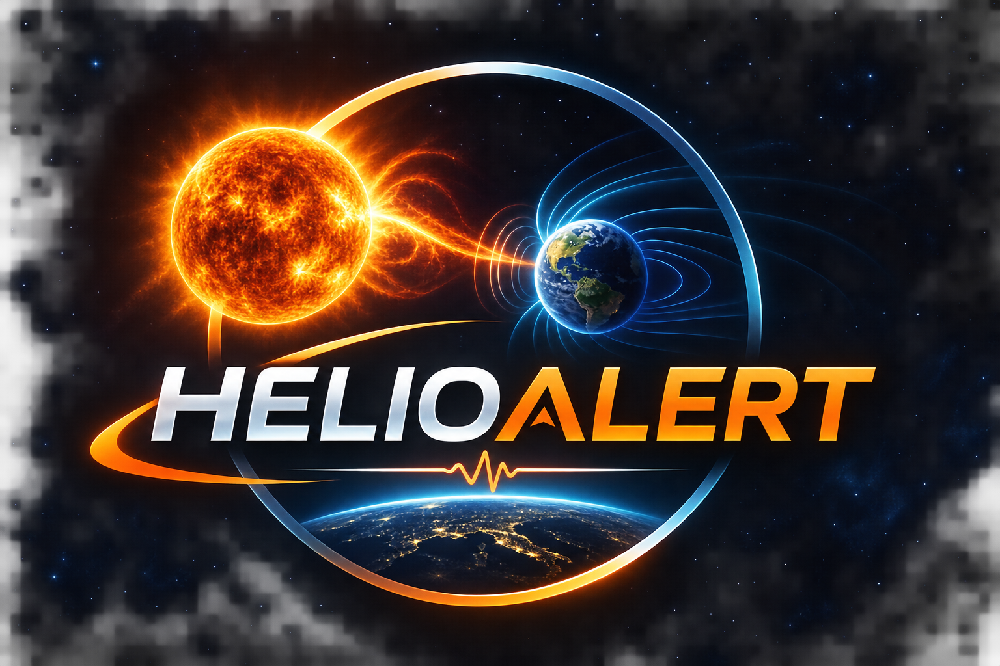
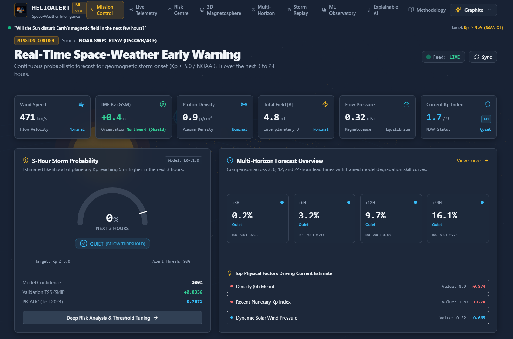
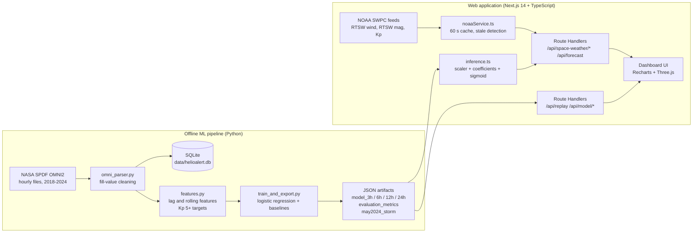
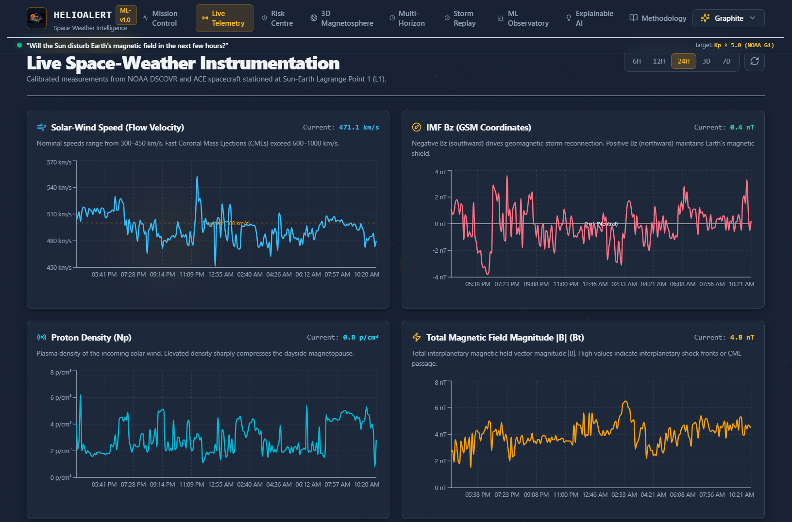
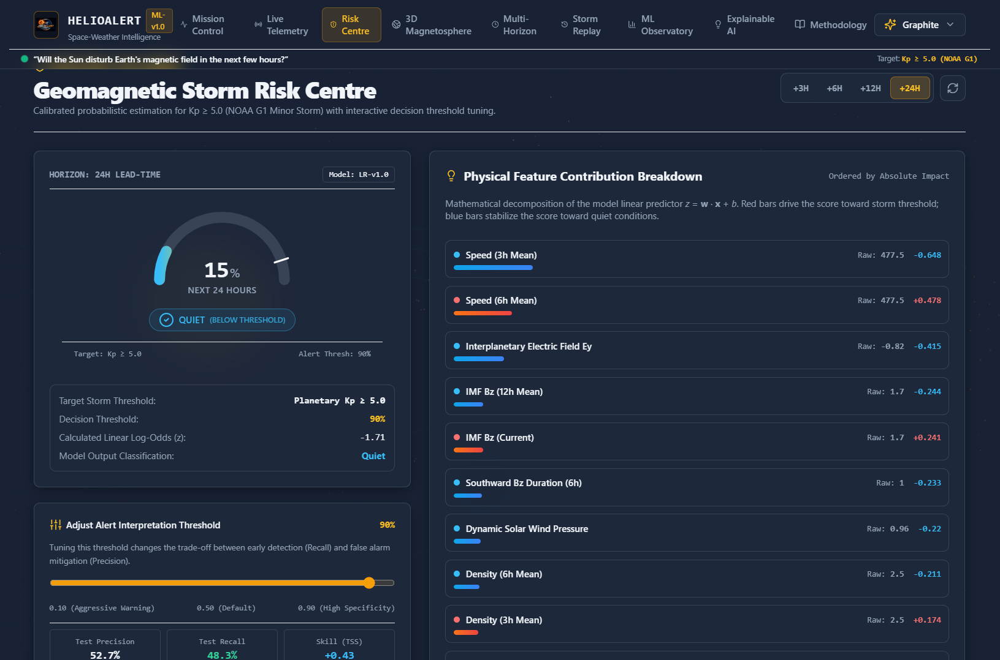
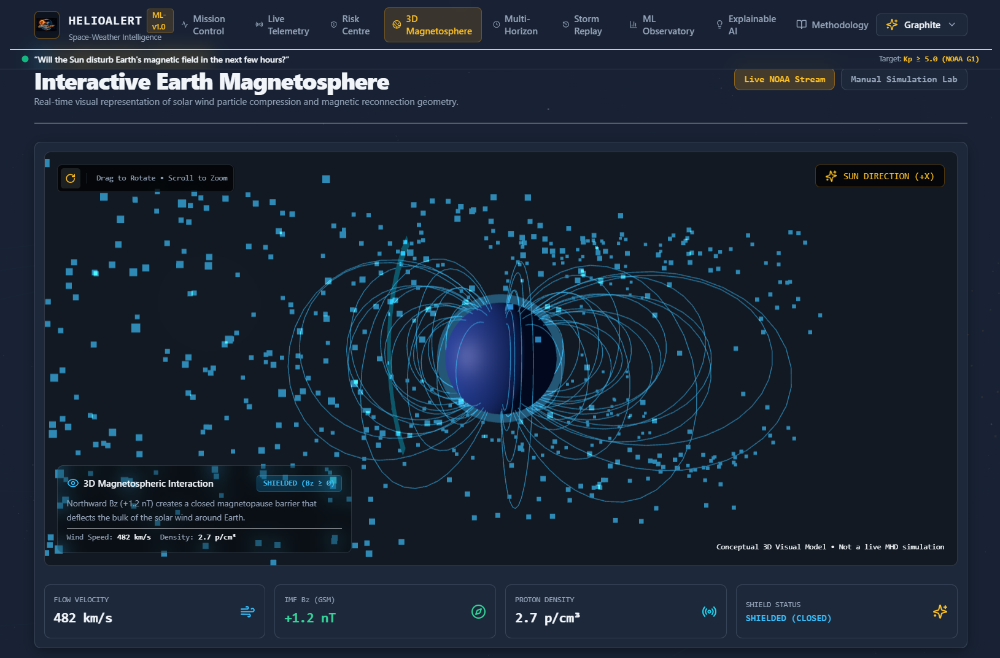
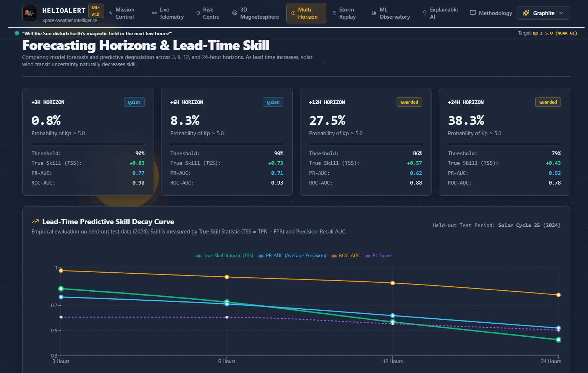
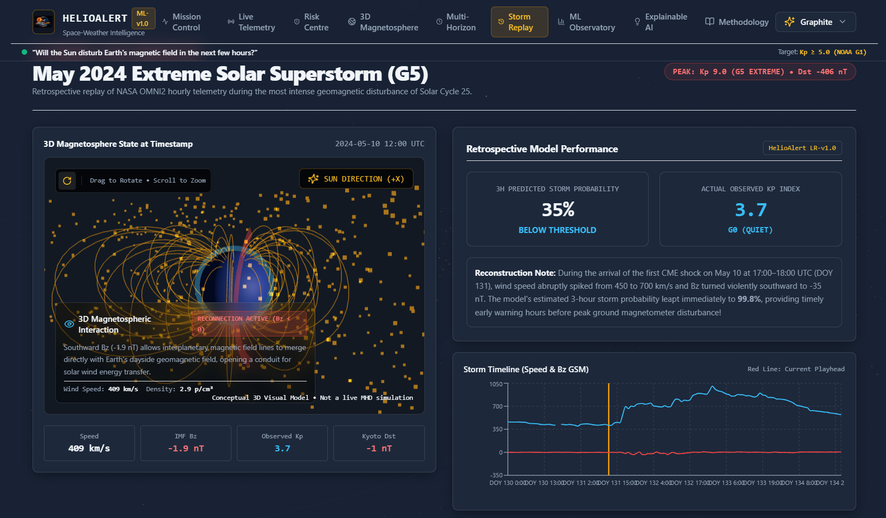

<div align="center">



<h1 align="center">HELIOALERT</h1>

<h3 align="center"><em>"Will the Sun disturb Earth's magnetic field in the next few hours?"</em></h3>

<p align="center">
An explainable space-weather intelligence and geomagnetic storm early-warning platform.<br>
HelioAlert combines historical NASA OMNI2 solar-wind observations, live NOAA SWPC measurements and trained machine-learning models to estimate whether the planetary Kp index will reach <strong>5 or higher</strong> (the NOAA G1 Minor Geomagnetic Storm threshold) within <strong>3, 6, 12 or 24 hours</strong>.
</p>


<a href="https://helioalert-taupe.vercel.app/"></a>
&nbsp;
<a href="https://github.com/dk-khandelwal06/helioalert"></a>
&nbsp;
<a href=""></a>

<br>



<sub><em>Mission Control: real-time space-weather monitoring and geomagnetic storm early-warning information in a single view.</em></sub>

</div>

---

## Table of Contents

- [Project Overview](#project-overview)
- [The Problem](#the-problem)
- [The Solution](#the-solution)
- [Key Features](#key-features)
- [Application Preview](#application-preview)
- [How It Works](#how-it-works)
- [Machine-Learning Methodology](#machine-learning-methodology)
- [Model Performance](#model-performance)
- [Technology Stack](#technology-stack)
- [Data Sources and Attribution](#data-sources-and-attribution)
- [Local Installation and Setup](#local-installation-and-setup)
- [Project Structure](#project-structure)
- [Live Demo and Links](#live-demo-and-links)
- [Disclaimer and Limitations](#disclaimer-and-limitations)
- [Author](#author)

---

## Project Overview

The Sun continuously releases a stream of charged particles, the **solar wind**. When a fast or dense stream reaches Earth carrying a magnetic field that points southward, it can couple strongly with Earth's magnetosphere and trigger a **geomagnetic storm**. Such storms can affect satellites, GNSS positioning accuracy, HF radio communications and power infrastructure, and they drive auroral displays.

Space-weather monitors measure the solar wind at the Sun-Earth **L1 Lagrange point**, roughly a million miles upstream of Earth. HelioAlert turns those upstream measurements into a probability: *how likely is it that planetary Kp reaches 5 or higher during the next 3, 6, 12 or 24 hours?*

**Why Kp ≥ 5?** The planetary Kp index (0 to 9) summarises global geomagnetic disturbance. A value of 5 is the point at which NOAA's geomagnetic storm scale begins (G1, Minor), so it is the natural line between ordinary activity and an actual storm.

HelioAlert is designed to be **transparent**: every probability is a weighted sum of physical measurements that the interface decomposes feature by feature, and every model is evaluated on a held-out year against simple baselines.

## The Problem

The solar wind varies constantly in speed, proton density, dynamic pressure and the strength and direction of the interplanetary magnetic field (IMF). The component that matters most for coupling with Earth is **IMF Bz** in GSM coordinates. When Bz turns southward (negative) while the wind is fast and dense, energy transfer into the magnetosphere increases and geomagnetic activity can rise sharply.

HelioAlert asks a focused question: **will planetary Kp reach 5 or higher within a selected forecasting horizon?**

Predicting this is a rare-event problem. In the held-out 2024 test set only **4.15%** of 3-hour windows contain a storm, so a model that always answers "no storm" is correct **95.85%** of the time while detecting **none** of them. Plain accuracy is therefore misleading here, and HelioAlert evaluates itself with precision, recall, F1, PR-AUC, ROC-AUC, the True Skill Statistic and explicit baselines instead.

## The Solution

HelioAlert joins seven stages into one workflow:

1. **Historical observations:** NASA SPDF OMNI2 hourly solar-wind and geomagnetic data, 2018 to 2024.
2. **Live measurements:** NOAA SWPC real-time solar-wind, magnetic-field and Kp feeds.
3. **Cleaning and feature engineering:** fill-value handling, short-gap filling, and lag/rolling-window features.
4. **Time-aware training:** chronological train, validation and test periods.
5. **Probability estimation:** class-weighted logistic regression with a validation-tuned alert threshold.
6. **Interactive visualization:** dashboards, charts, a 3D magnetosphere and a storm replay.
7. **Transparent evaluation:** confusion matrices, baselines and per-feature contribution breakdowns.



## Key Features

**Mission Control Dashboard**
A central monitoring view with current wind speed, IMF Bz, proton density, field magnitude, flow pressure and Kp, plus the 3-hour storm probability and a multi-horizon overview.

**Live Space-Weather Telemetry**
Time-series charts of solar-wind speed, IMF Bz, proton density and total field magnitude from NOAA data, with selectable ranges from 6 hours to 7 days, alongside observed Kp history and NOAA's Kp forecast.

**Geomagnetic Storm Risk Centre**
Model-estimated probabilities for each horizon, a risk category, a per-feature contribution breakdown and an adjustable alert-threshold slider that shows the precision/recall trade-off.

**Interactive 3D Earth Magnetosphere**
A Three.js scene of solar-wind particles and Earth's magnetic field that responds to speed, Bz and density, driven by live NOAA values or a manual simulation lab with presets. The scene is **conceptual and is not a live magnetohydrodynamic (MHD) simulation**; the application labels it as such.

**Multi-Horizon Forecasting**
Side-by-side 3, 6, 12 and 24-hour estimates with a lead-time chart showing how skill decays on the held-out test year.

**Historical Storm Replay**
A scrubbable, playable retrospective of the May 2024 geomagnetic superstorm built from stored NASA OMNI2 hourly data (9 to 13 May 2024). Replay probabilities are a **retrospective reconstruction** computed from hourly values; they are not a record of forecasts issued at the time.

**ML Performance Observatory**
Confusion matrix, precision, recall, F1, PR-AUC, ROC-AUC, True Skill Statistic, precision-recall and ROC curves, and a comparison with baselines, for every horizon.

**Explainable AI**
Shows the physical meaning of each input and the weight each feature carries in the model, and distinguishes statistical association from physical causation.

**Three Appearance Modes**
Deep Space (dark, the default), Graphite (medium) and Solar Day (light). The choice is stored in the browser's `localStorage`.

## Application Preview

<table align="center">
  <tr>
    <td align="center" width="50%">
      <h3>Mission Control Dashboard</h3>
      
      <br><sub>Current conditions, 3-hour storm probability and top physical drivers.</sub>
    </td>
    <td align="center" width="50%">
      <h3>Live Space-Weather Telemetry</h3>
      
      <br><sub>Solar-wind speed, IMF Bz, density and |B| with selectable time ranges.</sub>
    </td>
  </tr>
  <tr>
    <td align="center" width="50%">
      <h3>Geomagnetic Storm Risk Centre</h3>
      
      <br><sub>Probability gauge, feature contributions and adjustable alert threshold.</sub>
    </td>
    <td align="center" width="50%">
      <h3>Interactive 3D Magnetosphere</h3>
      
      <br><sub>Conceptual 3D model of solar-wind interaction. Not a live MHD simulation.</sub>
    </td>
  </tr>
  <tr>
    <td align="center" width="50%">
      <h3>Multi-Horizon Forecasting</h3>
      
      <br><sub>Four horizons with TSS, PR-AUC and ROC-AUC, and the lead-time skill curve.</sub>
    </td>
    <td align="center" width="50%">
      <h3>Historical Storm Replay</h3>
      
      <br><sub>Retrospective replay of the May 2024 superstorm from NASA OMNI2 data.</sub>
    </td>
  </tr>
</table>

## How It Works

1. **Historical data acquisition.** `ml/scripts/download_omni.py` downloads NASA SPDF OMNI2 hourly files (`omni2_2018.dat` to `omni2_2024.dat`) into `data/raw/`.
2. **Preprocessing.** `ml/src/omni_parser.py` parses the fixed-width records, converts year/day/hour to UTC timestamps, turns OMNI fill values into missing values, and converts Kp from tenths (`50`) to its native scale (`5.0`). Observations are also stored in a local SQLite database.
3. **Feature engineering.** `ml/src/features.py` forward-fills gaps of up to 3 hours, builds 19 lag and rolling-window features, and creates one target per horizon.
4. **Model training.** `ml/scripts/train_and_export.py` trains one model per horizon on 2018 to 2021 data and tunes its alert threshold on 2022 to 2023.
5. **Model evaluation.** Each model is scored once on the held-out 2024 data against baselines, and metrics are exported to `evaluation_metrics.json`.
6. **Live NOAA acquisition.** `lib/api/noaaService.ts` fetches NOAA SWPC real-time solar-wind, magnetometer and Kp feeds on the server, with an 8-second timeout, a 60-second in-memory cache and stale-data detection.
7. **Server-side inference.** `lib/model/inference.ts` applies the exported scaler, coefficients and intercept followed by a sigmoid, entirely in TypeScript, so no Python runtime is needed to serve predictions.
8. **Dashboard visualization.** Next.js pages render the results with Recharts and Three.js.

**Solar-wind parameters used**

| Parameter | Unit | Role |
|---|---|---|
| Flow speed | km/s | Faster wind carries more energy toward Earth |
| IMF Bz (GSM) | nT | Southward (negative) values favour coupling with Earth's field |
| Proton density | p/cm³ | Compresses the magnetosphere when elevated |
| Magnetic-field magnitude \|B\| | nT | Total strength of the interplanetary field |
| Flow pressure | nPa | Dynamic pressure of the wind |
| Electric field | mV/m | Convective electric field, −V × Bz |
| Kp index | 0 to 9 | Recent geomagnetic activity, and the basis of the target |

In the historical data, flow pressure and electric field come from OMNI2. In the live path they are computed from the latest speed, density and Bz (`1.67×10⁻⁶ · Np · V²` and `−V · Bz · 10⁻³`).

**The target.** For horizon *H*, the label is `1` if at least one hourly Kp value in the next *H* hours (`t+1 … t+H`) is **≥ 5.0**, otherwise `0`.

## Machine-Learning Methodology

**Problem type.** Binary classification, one independent model per horizon (3, 6, 12 and 24 hours).

**Model.** Logistic regression (`class_weight='balanced'`, `max_iter=1000`, `random_state=42`) on standardised features (`StandardScaler`, fitted on the training period only). Logistic regression was chosen for transparency: each prediction decomposes into per-feature contributions the interface can display.

**Class imbalance.** Storms are rare, so class weighting rebalances the loss. Results are judged on precision, recall, F1, PR-AUC, ROC-AUC and TSS rather than accuracy.

**Chronological split.** Random cross-validation would leak future information through autocorrelation, so the data is split by time:

| Period | Years | Purpose |
|---|---|---|
| Training | 2018 to 2021 | Fit scaler and model |
| Validation | 2022 to 2023 | Choose the alert threshold |
| Held-out test | 2024 | Final evaluation, including the May 2024 storm |

**Features (19).** Computed only from data at or before time *t*.

| Group | Features |
|---|---|
| Solar-wind speed | `flow_speed`, `speed_mean_3h`, `speed_mean_6h`, `speed_std_6h` |
| Proton density | `proton_density`, `density_mean_3h`, `density_mean_6h` |
| IMF Bz (GSM) | `bz_gsm`, `bz_mean_3h`, `bz_mean_6h`, `bz_mean_12h`, `bz_min_3h`, `bz_min_6h`, `bz_min_12h`, `southward_hours_6h` |
| Field and coupling | `bt`, `pressure`, `electric_field` |
| Geomagnetic state | `kp_recent` |

**Threshold tuning.** The decision threshold is the value in `0.10 … 0.90` (step 0.01) that maximises F1 on the validation period. It is then fixed and applied to the test period. Selected thresholds: **0.90** (3 h), **0.90** (6 h), **0.86** (12 h) and **0.79** (24 h). The Risk Centre lets users move the threshold to see the precision/recall trade-off.

**Leakage controls.**
- Chronological train, validation and test periods.
- Features use observations at or before *t*; targets use only *t+1 … t+H*, and a unit test checks that the storm hour itself is excluded from its own target.
- The scaler is fitted on the training period only.
- The threshold is chosen on validation data, never on the test set.

**Baselines and comparison.**
- *Always no storm:* predicts quiet every time.
- *Persistence:* predicts a storm if the current Kp is already ≥ 5.
- *HistGradientBoosting:* a non-linear comparison model (AUC metrics only).

## Model Performance

All figures below are read from `artifacts/metrics/evaluation_metrics.json` and describe the **held-out 2024 test period**: 8,648 hourly samples per horizon.

### 3-hour horizon

| Metric | Value |
|---|---|
| Decision threshold | 0.90 |
| Storm frequency | 4.15% (359 of 8,648) |
| Precision | 46.46% |
| Recall | 87.74% |
| F1-score | 60.75% |
| PR-AUC | 0.7671 |
| ROC-AUC | 0.9771 |
| True Skill Statistic (TSS) | 0.8336 |
| False alarm rate | 4.38% |

Confusion matrix (3 h): 315 true positives, 44 false negatives, 363 false positives and 7,926 true negatives.

> **Why accuracy misleads.** Because storms occupy only about 4% of the test windows, an "always no storm" classifier reaches **95.85% accuracy with 0% recall**. HelioAlert's value is in detecting storms, which is why TSS, recall and PR-AUC are reported instead.

### All forecasting horizons

| Horizon | Storm frequency | Threshold | Precision | Recall | F1 | PR-AUC | ROC-AUC | TSS | False alarm rate |
|---|---|---|---|---|---|---|---|---|---|
| 3 h | 4.15% | 0.90 | 46.46% | 87.74% | 60.75% | 0.7671 | 0.9771 | 0.8336 | 4.38% |
| 6 h | 5.33% | 0.90 | 50.00% | 77.01% | 60.63% | 0.7118 | 0.9262 | 0.7267 | 4.34% |
| 12 h | 7.48% | 0.86 | 50.31% | 61.82% | 55.48% | 0.6196 | 0.8787 | 0.5689 | 4.94% |
| 24 h | 11.37% | 0.79 | 52.72% | 48.32% | 50.42% | 0.5209 | 0.7840 | 0.4276 | 5.56% |

Skill decreases steadily as the lead time grows.

### Comparison with baselines

Each cell shows precision / recall / F1 / TSS.

| Horizon | Logistic regression (HelioAlert) | Persistence (current Kp ≥ 5) |
|---|---|---|
| 3 h | 46.5% / 87.7% / 0.608 / 0.834 | 87.5% / 69.9% / 0.777 / 0.695 |
| 6 h | 50.0% / 77.0% / 0.606 / 0.727 | 88.5% / 55.1% / 0.679 / 0.547 |
| 12 h | 50.3% / 61.8% / 0.555 / 0.569 | 89.6% / 39.7% / 0.550 / 0.394 |
| 24 h | 52.7% / 48.3% / 0.504 / 0.428 | 90.6% / 26.5% / 0.409 / 0.261 |

The model detects more storms than persistence at every horizon (higher recall and TSS), but persistence is considerably more precise, and has a higher F1 at 3 and 6 hours. In other words, the model trades extra false alarms for earlier detection. The largest model weight is `kp_recent`, so the model leans heavily on recent geomagnetic activity alongside solar-wind inputs.

**HistGradientBoosting comparison (PR-AUC / ROC-AUC)**

| Horizon | Logistic regression | HistGradientBoosting |
|---|---|---|
| 3 h | 0.7671 / 0.9771 | 0.7497 / 0.9637 |
| 6 h | 0.7118 / 0.9262 | 0.7070 / 0.9407 |
| 12 h | 0.6196 / 0.8787 | 0.6410 / 0.8811 |
| 24 h | 0.5209 / 0.7840 | 0.5092 / 0.7791 |

The non-linear model does not clearly outperform logistic regression, which supports keeping the simpler, explainable model.

### How to read these results

- **Retrospective evaluation.** Metrics come from re-running the models over archived 2024 data. They are not a record of operational forecasts issued in real time, and the Historical Storm Replay is likewise a retrospective reconstruction.
- **Kp resolution.** Kp is published every 3 hours and repeated across the hourly OMNI2 rows, so `kp_recent` and the target window can fall inside the same 3-hour Kp interval. Short-horizon scores should be read with this in mind.
- **Threshold range.** The 3 h and 6 h thresholds equal the upper edge (0.90) of the search range.
- **Single test year.** Results come from one year (2024) of one solar cycle and may not transfer to other periods.

## Technology Stack

| Layer | Technologies |
|---|---|
| Frontend | Next.js 14 (App Router), React 18, TypeScript 5, Tailwind CSS 3 |
| Visualization | Recharts, Three.js, Lucide React |
| Backend | Next.js Route Handlers, server-side NOAA fetching with in-memory caching, TypeScript model inference |
| Machine learning | Python, Pandas, NumPy, scikit-learn, SQLite (local persistence) |
| Data sources | NASA SPDF OMNI2, NOAA SWPC |
| Deployment | Vercel |

**API routes**

| Route | Purpose |
|---|---|
| `GET /api/space-weather/live` | Latest telemetry with predictions for all horizons |
| `GET /api/space-weather/plasma` | Solar-wind speed and density series (`range=6h\|12h\|24h\|3d\|7d`) |
| `GET /api/space-weather/magnetic-field` | IMF \|B\| and Bz series (same ranges) |
| `GET /api/space-weather/k-index` | Observed Kp and NOAA Kp forecast |
| `GET /api/forecast` | Model prediction for one or all horizons, with optional `horizon`, `threshold` and manual telemetry |
| `GET /api/replay` | May 2024 storm replay with retrospective model probabilities |
| `GET /api/model/metrics` | Evaluation metrics |
| `GET /api/model/status` | Model metadata |

## Data Sources and Attribution

| Source | Provides | Link |
|---|---|---|
| **NASA SPDF OMNI2** | Hourly solar-wind plasma, interplanetary magnetic field, Kp, Dst and related indices near Earth, used for training, evaluation and the storm replay | [spdf.gsfc.nasa.gov/pub/data/omni/low_res_omni](https://spdf.gsfc.nasa.gov/pub/data/omni/low_res_omni/) |
| **NOAA SWPC** | Real-time solar-wind and magnetometer data from the L1 spacecraft, observed planetary Kp and NOAA's Kp forecast | [services.swpc.noaa.gov/products](https://services.swpc.noaa.gov/products/) |

Live data is read from the NOAA SWPC `rtsw_wind_1m`, `rtsw_mag_1m`, `noaa-planetary-k-index` and `noaa-planetary-k-index-forecast` JSON products.

**Acknowledgements.** Historical data courtesy of the NASA Space Physics Data Facility (SPDF) and OMNIWeb. Real-time data courtesy of the NOAA Space Weather Prediction Center (SWPC).

HelioAlert is an **independent project**. It is not an official NASA or NOAA product and is not endorsed by either organisation.

## Local Installation and Setup

### Prerequisites

- **Node.js 18.17 or later** (required by Next.js 14) and **npm**
- **Python 3** with `pip`, only if you want to retrain the models (the project was developed with Python 3.13)

### Clone the repository

```bash
git clone https://github.com/dk-khandelwal06/helioalert.git
cd helioalert
```

### Install dependencies

```bash
npm install
```

### Environment configuration

No API keys or secrets are required: the application reads public NOAA SWPC feeds without authentication. `.env.example` lists two optional values (`NEXT_PUBLIC_APP_URL` and `NODE_ENV`); the current code does not read any environment variable, so you can run the application without creating a `.env` file.

### Run locally

```bash
npm run dev
```

Open [http://localhost:3000](http://localhost:3000).

For a production build:

```bash
npm run build
npm run start
```

### Retrain the models (optional)

Pre-trained model files are included, so this step is only needed to reproduce or change the training.

```bash
pip install -r requirements.txt
python ml/scripts/download_omni.py     # downloads NASA OMNI2 files (2018-2024) into data/raw/
python ml/scripts/train_and_export.py  # trains models and writes artifacts/
```

The training script writes its output to `artifacts/` and creates a local SQLite database in `data/`. The web application loads the bundled copies in `lib/model/data/`, so after retraining copy the updated JSON files (`model_*.json`, `evaluation_metrics.json`, `may2024_storm.json`) from `artifacts/` into that folder.

### Run the tests

```bash
python ml/tests/test_ml_pipeline.py
python tests/test_inference_parity.py
```

## Project Structure

```text
helioalert/
├── app/                      # Next.js App Router
│   ├── page.tsx              # Mission Control dashboard
│   ├── live/                 # Live Telemetry
│   ├── risk/                 # Storm Risk Centre
│   ├── magnetosphere/        # Interactive 3D Magnetosphere
│   ├── forecasts/            # Multi-Horizon Forecasting
│   ├── replay/               # Historical Storm Replay
│   ├── performance/          # ML Performance Observatory
│   ├── explainability/       # Explainable AI
│   ├── methodology/          # Methodology and attribution
│   └── api/                  # Route Handlers (space-weather, forecast, replay, model)
├── components/               # dashboard, layout, space (3D) and theme components
├── lib/
│   ├── api/noaaService.ts    # NOAA SWPC fetching, caching, stale detection
│   └── model/                # TypeScript inference + bundled model/metrics JSON
├── ml/
│   ├── scripts/              # download_omni.py, train_and_export.py
│   ├── src/                  # omni_parser.py, features.py, database.py
│   └── tests/                # ML pipeline unit tests
├── artifacts/                # Exported models, evaluation metrics, storm replay data
├── tests/                    # Inference parity test
├── assets/                   # Logo and README screenshots
└── public/                   # Static files
```

## Live Demo and Links

<div align="center">

<a href="https://helioalert-taupe.vercel.app/"></a>
&nbsp;
<a href="https://github.com/dk-khandelwal06/helioalert"></a>
&nbsp;
<a href="https://www.linkedin.com/in/daksh-khandelwal-b02748391/"></a>

<br>

[Explore Live Application](https://helioalert-taupe.vercel.app/) · [View Source Code](https://github.com/dk-khandelwal06/helioalert) · [Connect on LinkedIn](https://www.linkedin.com/in/daksh-khandelwal-b02748391/)

</div>

## Disclaimer and Limitations

HelioAlert is an **independent educational and experimental early-warning platform**. It is **not** an official forecast, watch or warning from NOAA SWPC, NASA or any space-weather agency.

- **Estimates, not guarantees.** Model probabilities are statistical estimates. They can miss storms and raise false alarms, and they are not guaranteed to be correct.
- **Live data can be delayed, unavailable or revised.** If NOAA feeds cannot be reached, the application falls back to cached data or to a static quiet-conditions placeholder and marks the data as stale or degraded.
- **L1 observations are upstream.** Measurements at L1 describe the solar wind before it reaches Earth and do not imply immediate conditions at Earth.
- **Live inputs are simplified.** Models were trained on rolling-window features, but the live path supplies only the latest measurements; rolling features are filled in from the current values or default assumptions, so live probabilities approximate the training setup.
- **Retrospective results.** The 2024 evaluation and the May 2024 replay are reconstructions on archived data, not real-time historical forecasts. See [How to read these results](#how-to-read-these-results).
- **Limited training history.** The models use seven years of data (2018 to 2024), and evaluation uses a single test year.
- **Visualization.** The 3D magnetosphere is a conceptual illustration, not an MHD simulation.

Consult official space-weather services such as [NOAA SWPC](https://www.swpc.noaa.gov/) for operational decisions.

## Author

<div align="center">

**Daksh Khandelwal**

Designed and built HelioAlert end to end: the data pipeline, machine-learning models, inference engine and web application.

<a href="https://www.linkedin.com/in/daksh-khandelwal-b02748391/"></a>
&nbsp;
<a href="https://github.com/dk-khandelwal06"></a>

<sub>HelioAlert uses data courtesy of NASA SPDF/OMNIWeb and NOAA SWPC. It is an independent project and is not affiliated with or endorsed by NASA or NOAA.</sub>

</div>
